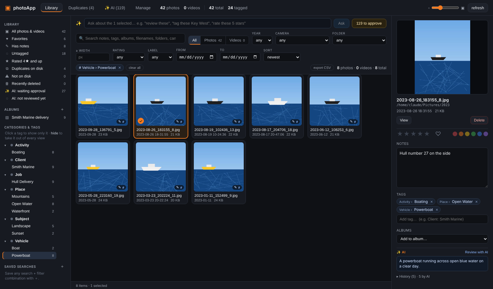
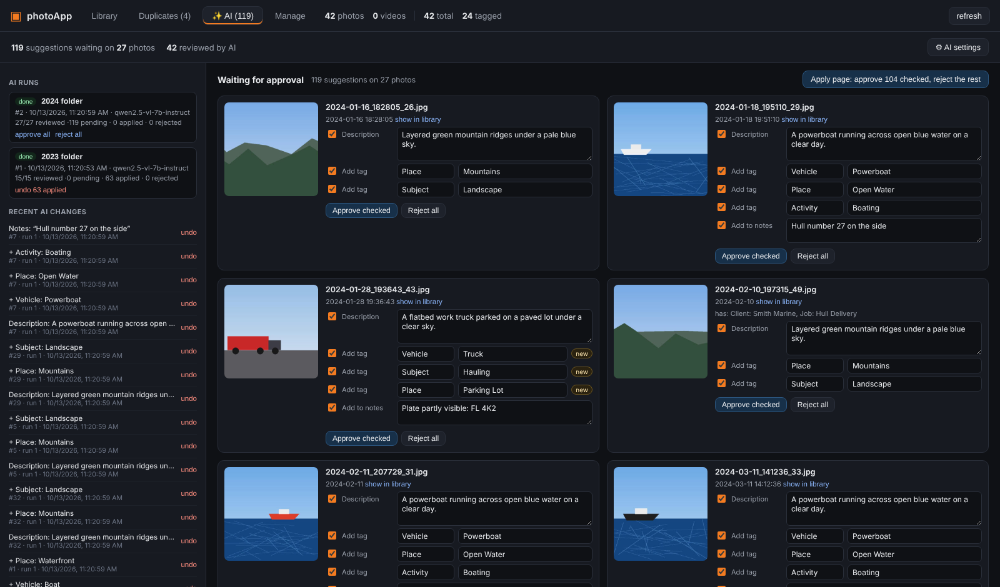

# photoApp

**A fast, private desktop app for organizing a large personal photo and video library on Windows — with tags, notes, search, safe file management, and an optional local AI assistant that suggests descriptions and tags for you to approve.**

Built with [Tauri 2](https://tauri.app) (Rust) and [Svelte 5](https://svelte.dev). Your photos stay where they are; photoApp keeps its catalog in a single SQLite file next to the app.



---

## Features

### Organize
- **Tags with categories** — type `Client: Smith Marine` and the tag lands in the *Client* category (created on the fly). Rename, merge, recolor and re-categorize in the **Manage** tab.
- **Notes** on every photo, saved as you type and fully searchable.
- **Ratings, favorites and color labels** — keys `1`–`5`, `0`, `F` work on a whole selection.
- **Albums** for jobs, customers or events; a photo can be in many albums.
- **Bulk editing** — select hundreds of photos (click, Ctrl-click, Shift-click, Ctrl+A) and tag, rate, label, add a note, add to an album, or move them in one go.

### Find
- **One search box** across notes, tags, categories, albums, AI descriptions, file names, folders and camera — supports `"exact phrase"` and `-exclude`.
- **Filters**: photos / videos, year, camera, folder, rating, color label, date range, *untagged*, *has notes*, *favorites*, duplicates.
- **Show only** or **hide** any tag or category — e.g. hide everything tagged *DOG* while you tag the rest.
- **Saved searches** and **CSV export** of any result set (with tags, albums and notes).

### Manage files safely
- **Keeps up with Explorer** — add, move, rename, edit or delete files outside the app and the catalog follows (live file watcher + sync at launch). Notes and tags follow a photo by its *content* (SHA-256), not its path, so moving or renaming never loses them.
- **Move files into folders** from the app — previewed first, never overwrites, every move undoable.
- **Delete to the Windows Recycle Bin** — never permanent, with *Undo* and a *Recently deleted* view. The app checks each drive really has a Recycle Bin and refuses to delete otherwise.
- **Duplicate finder** (byte-identical copies) with non-destructive staging.
- **Unplugged-drive safe** — an offline drive is reported, never mass-marked as missing.
- **Automatic daily catalog backups**, plus one before every bulk cleanup.

### View
- Virtualized grid that stays smooth with tens of thousands of items, adjustable thumbnail size.
- Full-screen viewer with **mouse-wheel zoom toward the cursor**, drag to pan, double-click to zoom, keyboard navigation, and inline video playback.

### ✨ AI assistant (optional)
Connect a **local** model (LM Studio, Ollama, llama.cpp, vLLM) or a cloud API (**OpenAI-compatible** or **Anthropic-compatible**).

- **Review photos**: a vision model looks at each photo and suggests a description, tags (reusing *your* existing tag names) and a note.
- **You approve everything** — nothing changes until you approve it. Edit any suggestion, untick what you don't want, approve per photo, per suggestion, or per run.
- **Ask in plain English**: *"boat photos from 2019"*, *"review everything untagged"*, *"tag these Key West and rate them 4"*. Searches apply instantly; changes go to the approval queue.
- **Full per-photo history with undo** — every change, yours or the AI's, is recorded with its before/after value. Undo one change, everything the AI did to a photo, or an entire AI run.



---

## Requirements

| | |
|---|---|
| OS | Windows 10 or 11 (64-bit). The code is cross-platform Rust/Tauri, but only Windows is tested. |
| WebView2 | Pre-installed on Windows 11 and current Windows 10. Otherwise get the [Evergreen runtime](https://developer.microsoft.com/microsoft-edge/webview2/). |
| Rust | Stable toolchain, 1.85 or newer (edition 2024), MSVC target — install with [rustup](https://rustup.rs). |
| C++ build tools | [Visual Studio Build Tools](https://visualstudio.microsoft.com/visual-cpp-build-tools/) with the *Desktop development with C++* workload. |
| Node.js | 20.19+ or 22.12+ (for the Vite / Svelte front end). |
| ffmpeg | *Optional* — only for video thumbnails. On `PATH`, or set its path in `config.toml`. |
| AI model | *Optional* — any OpenAI- or Anthropic-compatible endpoint; a **vision** model is needed to review photos. |

## Quick start

```bat
git clone https://github.com/<your-user>/photoApp.git
cd photoApp
build.bat
src-tauri\target\release\photoapp.exe
```

`build.bat` builds the front end and a single release `photoapp.exe` with the UI embedded (the first build downloads dependencies and takes several minutes). It refuses to run while photoApp is open, and saves its output to `build.log`.

**First run** creates `config\config.toml` pointing at your *Pictures* folder and catalogs it. To use other folders, edit the file and restart:

```toml
exclusions = ["D:/Photos/Temp"]          # folders to skip (prefix match)
# ffmpeg = "C:/tools/ffmpeg/bin/ffmpeg.exe"

[[roots]]
name = "Photos"
path = "D:/Photos"

[[roots]]
name = "Phone backup"
path = "E:/Phone"
```

See [`config/config.example.toml`](config/config.example.toml). Use forward slashes (or doubled backslashes) in paths.

## Setting up the AI assistant

1. Start a local server — e.g. in **LM Studio** load a vision model (Qwen2.5-VL, Gemma 3, LLaVA, Llama 3.2 Vision…) and start the server, or run **Ollama**.
2. In photoApp open **✨ AI → AI settings**, pick a preset (LM Studio `http://localhost:1234/v1`, Ollama `http://localhost:11434/v1`, OpenAI, Anthropic) or type your server's URL (another PC on your network works too).
3. **List models**, choose one, add a few lines about your library under *Your instructions*, then **Save & test** — it checks a text reply and a vision reply on one of your photos.
4. Select a few photos → **✨ Review N with AI** → approve in the **AI** tab.

Tips:
- **"Thinking" models** (e.g. Qwen3) reason before answering; if reviews fail with *"spent all reply tokens thinking"*, raise **Max reply tokens** (default 4096) or use a non-thinking model.
- Start with 20–50 photos to judge a model before running thousands. A local vision model typically takes seconds to a minute per photo.
- **Privacy**: with a local server nothing leaves your PC. With a cloud provider, a downsized copy of each reviewed photo plus its file name, folder, date and existing tags is sent to that provider.

## Keyboard shortcuts

| Where | Keys |
|---|---|
| Grid | Click / Ctrl-click / Shift-click select · `Ctrl+A` select all · `Esc` clear · `Enter` open · `←` `→` move |
| Grid (with selection) | `1`–`5` rate · `0` clear rating · `F` toggle favorite · `Del` delete to Recycle Bin |
| Viewer | `←` `→` previous / next · mouse wheel zoom · drag to pan · double-click zoom · `+` `−` `0` · `Esc` un-zoom, then close |
| Tag box | `Enter` or `,` adds · `Category: name` files it under a category |

## Where your data lives

Everything the app owns is under the folder that contains `config\` (the project folder when you run it from a checkout):

| Path | What |
|---|---|
| `config\config.toml` | Library folders and options |
| `data\catalog.db` | The catalog — tags, notes, albums, ratings, history, AI suggestions and settings (SQLite) |
| `data\thumbs\` | Thumbnail cache (safe to delete; rebuilt) |
| `data\backups\` | Catalog snapshots — the newest 20 are kept |
| `data\exports\`, `data\reports\` | CSV exports and move / duplicate reports |

**Back up** `data\catalog.db` (or a snapshot from `data\backups\`) — that file is your organizing work. To restore, close the app and copy a backup over `catalog.db`. To uninstall, delete the folder; the app writes nothing to the registry and installs no services.

The app never modifies your photos' contents. File operations are limited to moves you preview and approve, and deletes that go to the Recycle Bin.

## Command line

`photoapp.exe` with no arguments opens the app. From a terminal:

| Command | What it does |
|---|---|
| `photoapp.exe rescan` | Sync the catalog with disk (new / edited / moved / deleted files) and print a summary |
| `photoapp.exe backup` | Snapshot the catalog into `data\backups\` |
| `photoapp.exe scan` | Full re-hash of every file (rarely needed) |
| `photoapp.exe thumbs` | Generate any missing thumbnails |
| `photoapp.exe watch` | Run the file watcher in the terminal |
| `photoapp.exe api [--port 8787]` | JSON API for browser development mode |
| `photoapp.exe exifcheck <file.jpg>` | EXIF diagnostic for one file and its folder |

Environment overrides (handy for testing against a scratch catalog): `PHOTOAPP_CONFIG`, `PHOTOAPP_DB`, `PHOTOAPP_THUMBS`, `PHOTOAPP_FFMPEG`.

## Development

```bat
:: terminal 1 — JSON API used by the browser dev UI
cd src-tauri
cargo run -- api

:: terminal 2 — UI with hot reload on http://localhost:1420
cd frontend
npm install
npm run dev
```

Run the Rust tests with `cargo test` in `src-tauri`. See [docs/ARCHITECTURE.md](docs/ARCHITECTURE.md) for how the pieces fit together and [CONTRIBUTING.md](CONTRIBUTING.md) for guidelines.

## Known limitations

- Windows is the only tested platform.
- HEIC images are cataloged but get no thumbnail (the image decoder doesn't read HEIC); RAW formats are not cataloged.
- Video thumbnails need ffmpeg; `.mov` / `.avi` may not play inline (WebView2 limitation) — use *Open file*.
- Duplicate detection is exact (byte-identical); visually similar photos are not grouped.
- AI search works over AI-written descriptions and your metadata — review photos first for visual search to work.

## License

[MIT](LICENSE) © 2026 Lane Palmer

## Acknowledgments

[Tauri](https://tauri.app), [Svelte](https://svelte.dev), [Vite](https://vite.dev), [rusqlite](https://github.com/rusqlite/rusqlite) / SQLite FTS5, [image](https://github.com/image-rs/image), [notify](https://github.com/notify-rs/notify), [trash](https://github.com/Byron/trash-rs), [ureq](https://github.com/algesten/ureq), [rayon](https://github.com/rayon-rs/rayon).
